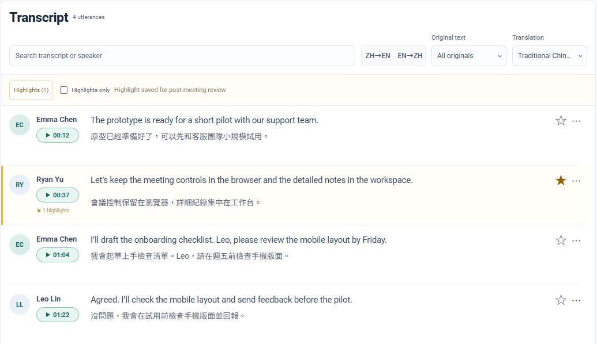
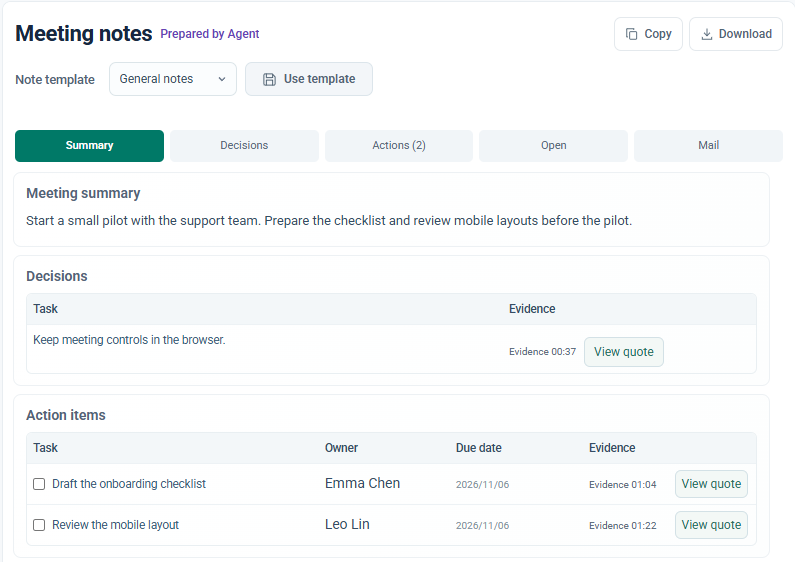

<h1 align="center">Duck Meeting </h1>

<strong>Record the meeting. Review the transcript. Let your Agent prepare the follow-up.</strong> 
Duck Meeting captures Google Meet, Microsoft Teams, and in-person meetings in a local workspace. Use your existing Codex or Claude Code account to turn the transcript into decisions, tasks, and an editable email draft.

    
   
   
   

<a href="https://github.com/jaylooloomi/i-want-to-duck-meeting/releases/latest">Download for Windows x64</a> · <a href="README.zh-TW.md">繁體中文</a>

 
Windows app screenshot · v0.3.8 · fictional meeting data

## What you can do

- **Capture and follow live.** Record audio, read live captions and translations, and star important moments. The dedicated Meet or Teams window can show recent captions and stop capture. Meet also supports pause and resume.
- **Review the evidence.** Search originals and translations, play audio from a transcript timestamp, and jump from a linked decision or task to the source. Compare platform captions with an existing audio transcript using `openmeeting crosscheck <ID>`, or use `openmeeting report <ID>` to draft a review and verify quotations.
- **Follow up.** Give your Agent a notes template, track tasks across meetings, and edit or copy a local email draft.

## Get started

1. Run the Windows installer and select the Codex skill or Claude Code plugin. Install Chrome and your chosen Agent separately. The Claude Code integration requires the `claude` CLI.
2. In a new Agent chat, enter `Record this meeting <URL>`. Sign in or wait for host admission when required. For an in-person meeting, start a microphone recording from Duck Meeting.
3. After the call, ask your Agent to summarize the meeting. Review the summary, decisions, tasks, and email draft in Duck Meeting.

[Installation and updates](docs/installation.md) · [Evidence review guide](docs/transcript-review.md)

## Where the data goes

| Step | Data |
| --- | --- |
| Capture | Recordings, captions, and transcripts are saved on your computer. |
| Live translation | When enabled, transcript text is sent to Google Translate. |
| Meeting notes | Your signed-in Agent processes meeting text using its existing account allowance. Duck Meeting requires no separate summary API key. |

[Agent workflow and architecture](docs/AGENT_ARCHITECTURE.md)

Close-up screenshots of the transcript and meeting notes

## Releases and license

- **v0.3.9** fixes transcript flicker as translations arrive in batches. [Release notes](docs/releases/v0.3.9.md)
- **v0.3.8** adds meeting controls, transcript comparison, and quotation review. [Release notes](docs/releases/v0.3.8.md)

Created by Arthur Wang ([@jaylooloomi](https://github.com/jaylooloomi)). Feedback and contributions are welcome. [Open an issue](https://github.com/jaylooloomi/i-want-to-duck-meeting/issues) · [MIT license](LICENSE)
