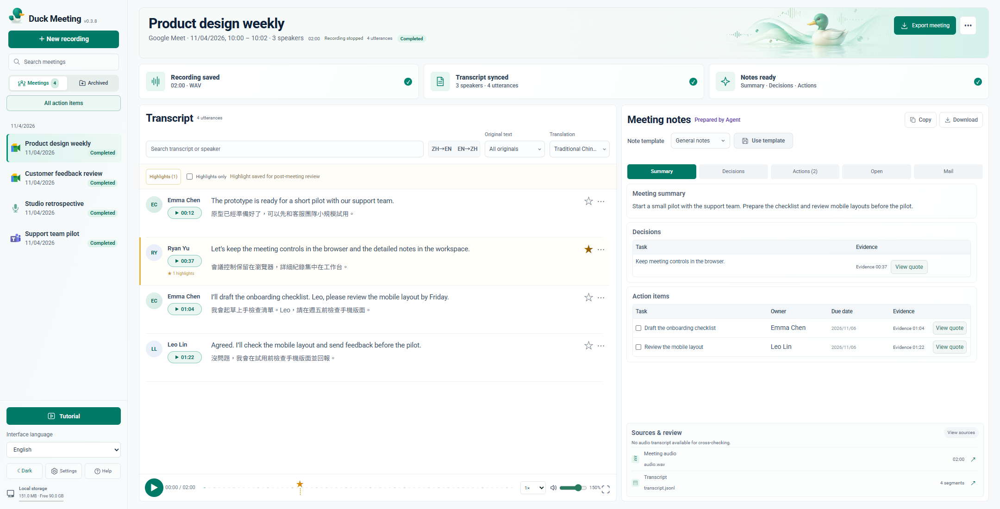

<h1>Duck Meeting </h1>

[繁體中文](README.zh-TW.md)

Record Google Meet, Microsoft Teams, and in-person meetings. Review audio and transcripts in a local workspace, then ask your existing Codex or Claude Code Agent for decisions, tasks and an email draft.

[Download Windows Setup](https://github.com/jaylooloomi/i-want-to-duck-meeting/releases/latest) · v0.3.8 · Windows 10/11 x64

*Duck Meeting v0.3.8 workspace, captured with fictional meeting data.*

| Stage | What you can do |
| --- | --- |
| Start | Open a dedicated Meet or Teams window, or start an in-person recording. |
| Record | Follow bilingual transcripts and mark key moments. |
| Review | Replay a timestamp or jump from a linked decision back to the source. |
| Follow up | Use a notes template, track tasks across meetings and edit an email draft. |

## New in v0.3.8

- **In-meeting controls.** View recent captions and end recording from the dedicated Meet or Teams window. Meet also supports pause and resume.
- **Transcript comparison.** `openmeeting crosscheck <ID>` aligns platform captions with an existing audio transcript and flags differences in numbers, dates and wording.
- **Evidence review.** `openmeeting report <ID>` creates a review draft. With reviewed JSON, it checks quotations against the cited source segments.

[Usage guide](docs/transcript-review.md) · [Release notes](docs/releases/v0.3.8.md)

## Start in three steps

1. Run Setup and select your Agent integration. Install Chrome and your chosen Agent separately. Claude Code integration requires the `claude` CLI.
2. Paste a Meet or Teams link into a new Agent chat and ask it to record. Sign in and wait for host admission as needed.
3. After the call, ask “summarize this meeting.” Review notes, tasks and the local email draft in Duck Meeting.

## Account and data

Audio and transcripts are saved locally. The standard workflow uses your existing Agent allowance without a separate summary API key. Agent processing can send text to its provider, and optional live translation sends text to Google. v0.3.8 meeting controls were tested with a simulated Meet session. Live Meet and Teams validation is pending.

[Installation](docs/installation.md) · [Architecture](docs/AGENT_ARCHITECTURE.md) · [MIT license](LICENSE)
