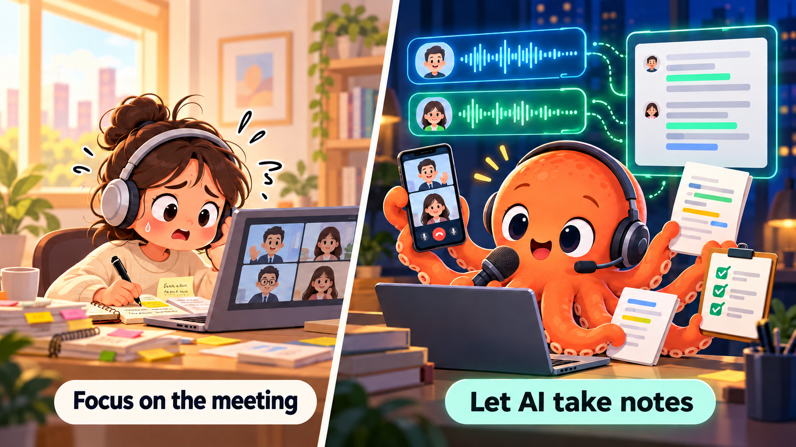
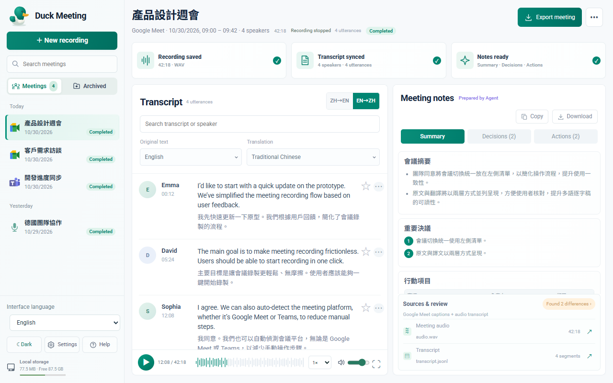
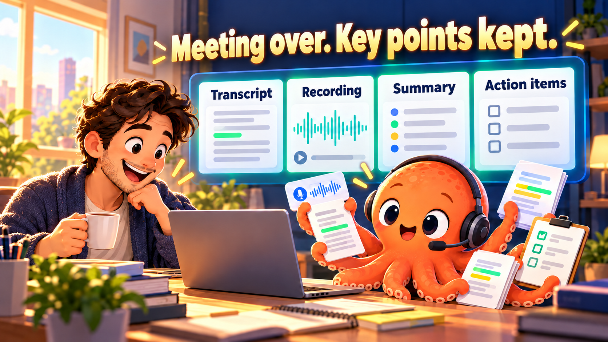

<h1 align="center">i-want-to-duck-meeting 🎙️</h1>

<p align="center">
  <b>Focus on the meeting. Let AI keep the notes.</b><br>
  Paste a Google Meet or Microsoft Teams link to capture transcripts and audio.<br>
  Afterward, ask “summarize this meeting” to turn the record into decisions and action items.
</p>

<p align="center">
  <a href="LICENSE"></a>
  
  
  
  
  
  <a href="README.md"></a>
  <a href="README.zh-TW.md"></a>
</p>

<p align="center"></p>
<p align="center"><sub>Illustrated use case, not a screenshot of the application.</sub></p>

## Windows installer (recommended)

Download **DuckMeeting-0.3.3-Setup-x64.exe** from [GitHub Releases](https://github.com/jaylooloomi/i-want-to-duck-meeting/releases/latest). Run Setup, choose Codex / Claude Code integrations and a desktop shortcut, then open a new Agent conversation and paste a meeting link. Claude integration requires the Claude CLI; both Agents and Google Chrome remain separately installed applications. No Git, global Node.js or npm is required for the installer edition.

- Installs per user, without administrator rights, under `%LOCALAPPDATA%\Programs\DuckMeeting`. Bundled Node.js 24.13.0 and Playwright runtime are included. Windows x64 only (Windows 10/11).
- Recordings, notes, sign-in profile and downloaded models live separately under `%LOCALAPPDATA%\DuckMeeting\data`. Existing source-checkout data is not migrated automatically. Installer workspace: `http://127.0.0.1:8792`; source checkout keeps port 8791.
- Speech models/Python audio dependencies are not bundled. First audio use prepares them online; **Start menu → Duck Meeting → Prepare speech recognition** can prepare them in advance with visible progress. Keep that window open until completion.
- **Start menu → Duck Meeting → Check for updates** checks stable GitHub Releases, asks before downloading, verifies SHA-256 against the release checksum file and opens Setup. Private repositories require access; when API access is unavailable, it opens the Releases page for browser sign-in/manual download. It does not store a GitHub token.
- Running a newer Setup upgrades the same installation and preserves data. Finish recordings before upgrading or uninstalling.
- Remove via **Windows Settings → Apps → Duck Meeting**, or the Start-menu uninstall shortcut. Managed skills are removed only if still owned by this installation. Data is kept by default; interactive uninstall offers a second-confirmed deletion option. Silent uninstall always keeps data.
- This first installer is **not code-signed**; Windows may show an unknown-publisher/SmartScreen prompt. SHA256SUMS is an integrity check, not publisher signing.

Developers: install the official Inno Setup compiler, set `ISCC_PATH`, then run `npm ci` and `npm run build:windows`. The optional manual GitHub Actions workflow builds and smoke-tests the package. See [installer QA and limitations](docs/qa/reports/windows-installer-030.md).

## What’s new in 0.2.0

Four interface languages (Traditional Chinese, English, Japanese and Korean), responsive light/dark layouts, platform-specific meeting icons and meeting links, consistent settings and menus, and Chinese→English as the default display preset. German/Japanese/Korean original views preserve untagged legacy content. Interface language, original-text display and transcript translation are separate settings.




## Core features

**One local Windows meeting recorder, with a Codex skill and a Claude Code plugin as its two AI entry points.**

| Feature | What it does |
|---|---|
| 🔗 **Start with a link** | Paste a Meet or Teams link into your AI conversation; the same local CLI starts the recording |
| 📝 **Transcripts and sources** | Meet preserves captions, speaker names, and timestamps; local ASR preserves text, audio lanes, and estimated speaker labels |
| 🎙️ **Saved audio** | Meet records received meeting audio; Teams saves the local microphone, playback audio, and an aligned mix separately |
| 🇹🇼 **Local Chinese ASR** | Microphone and Teams modes use Paraformer Chinese int8, Traditional Chinese conversion, and spoken digit formatting; Whisper provides whole-recording fallback transcription |
| 👀 **Live workspace & history** | Joining a meeting automatically opens the local web panel (`http://127.0.0.1:8791`) with a persistent left sidebar of all meetings (supporting **one-click ZIP Export / Archive / Unarchive / Delete**), side-by-side live transcript & structured summary panes, primary language filtering, and real-time bilingual translation (`zh-TW` / `en` / `ja`) |
| ✅ **Structured meeting notes** | When a meeting ends, the owning Codex conversation receives an Agent handoff request; the Agent reads the transcript and writes `summary.md`. The backend hands off to the owning Agent rather than generating model output |

Recording and local ASR do not require an additional cloud speech API key. **Summaries are processed by your chosen AI service**; the entire workflow is not necessarily offline.

## Autonomous Google Meet validation

An explicit test command, `node scripts/verify-meet-live.js --live --seconds 30`, creates a private test meeting, sends newly generated synthetic speech, and records it from a second muted page in the same signed-in browser context. It requires the existing Windows/Chrome and local Paraformer setup. [Commands and evidence limits](docs/live-google-validation.md).

The 2026-10-25 run captured 25.216 seconds of received audio; offline Paraformer matched the complete test sentence, Google Meet, and 1357. Google native captions contained errors, so the overall result is **partial**. A subsequent 120.064-second run contained at least one complete matching sentence in both native captions and decoded audio; other repetitions still contained errors. This verifies a synthetic same-account remote path, not two human participants or independent organizations. Captions and decoded recording are checked separately against the actual WAV hash. Test artifacts remain local and ignored by Git.

## Teams native captions first (live acceptance pending)

A Teams link starts a dedicated Chrome profile. The worker attempts to join, mute its microphone/camera, enable captions, and select Traditional Chinese. Sign-in, permissions or host admission may still require your action. Audio devices use saved settings or Windows defaults.

Native captions replace equivalent, nearby Paraformer results. Unmatched ASR remains so captions from only one participant cannot erase the other participant. Raw events remain in `transcript-native.jsonl` and `transcript-paraformer.jsonl`; differently worded results may both appear. Native times are reception times, and unknown speaker identities remain unknown.

Check `teamsBrowser.state`, `nativeCaptions` and `audioHealth` independently. `--no-open` skips the native browser and keeps audio/ASR only; omit it for normal use. Stop with `leave <ID>` to finalize audio and close the dedicated browser.

Controlled Chrome tests pass; real Teams acceptance is pending. Private platform event formats may change. Audio capture starting does not prove membership, successful captions, or recorded speech. See [implementation and acceptance notes](docs/teams-native-captions.md).

## Google Meet native account selection

Paste the link; the dedicated Chrome window opens **Google's own account chooser/sign-in page**, even with existing signed-in accounts. Pick your account or use another account and complete verification yourself. Keep the window open. There is no custom localhost account form.

The worker first verifies the authenticated account on Google's Meet home page, binds that email to the original meeting, and checks the actual prejoin identity again before requesting admission. Meet's native switch-account header is supported alongside its Google Account control. A different, missing or ambiguous identity stops the flow; profile order, URL parameters and chat text do not count as proof. A default-account redirect without an explicit choice or login is rejected.

Account choice and host admission are detected automatically; you do not need to reply “selected” or “admitted” to keep the recording worker moving. AI notifications depend on the host; automatic continuation does not by itself guarantee a proactive chat notification.

`selecting_account` means waiting on the native Google page. Waiting defaults to ten minutes (`OPENMEETING_LOGIN_TIMEOUT_MS`); `leave <ID>` cancels. Recording still requires actual admission and separate audio/caption checks. [Flow and validation](docs/meet-login-flow.md).

On October 26, 2026, a user-operated Google Meet test verified the chosen account, host admission, and 121.7 seconds of recording. Both native captions and decoded audio contained **1357**. “Google Meet” and “Arthur” still had recognition errors, so exact-sentence acceptance remains incomplete. [Evidence scope and limits](docs/meet-login-flow.md); private recordings and account data are not committed.

## Use cases

| Situation | Ask your AI | What you keep |
|---|---|---|
| 💻 **Google Meet project discussion** | “Join this meeting and record it” | Captions, speakers, timestamps, and meeting audio |
| 📱 **Teams call between a PC and a phone** | “Record this Teams meeting and verify both audio lanes afterward” | Separate local and remote recordings, transcripts, and a mix |
| 🪑 **In-person discussion** | “Open the local transcript page and record with the microphone” | Chinese transcripts, estimated speaker labels, and audio |
| 🔍 **Review during a meeting** | “Show the transcript so far” | Saved text and its sources |
| 📋 **After the meeting** | “Stop recording and summarize decisions and action items” | An AI-written `summary.md`, with the original transcript available for review |
| 🧪 **Verify the recording** | “Check that my test sentence and confirmation code were captured” | Content checks against the actual audio, rather than assuming a saved file means success |

## Install

Choose your AI tool and follow its three steps.

**Requirements:** Windows 10/11 · Git · Node.js 22 or later · Google Chrome · local Codex or Claude Code with access to this computer's files and processes. Claude integration also requires the `claude` CLI. Users of the private repository need read access first.

### OpenAI Codex

**1. Copy this into local Codex**

```text
Install the i-want-to-duck-meeting Codex skill for me:
1. Download https://github.com/jaylooloomi/i-want-to-duck-meeting, or reuse an existing checkout.
2. Run npm install in the project directory.
3. Run npm run setup -- --target codex.
4. Verify installation and report the skill location. Keep credentials and meeting data out of Git.
```

**2. Start a new local Codex conversation**

Let the new conversation load the installed skill. Restart Codex if it does not appear. The skill needs access to the Windows computer where it is installed; a cloud-only chat cannot directly use this computer's recording devices.

**3. Paste your actual meeting link**

```text
<Your Google Meet or Teams meeting link>
Record this meeting. Tell me when I need to sign in or grant permission.
```

To select the skill explicitly, use `$openmeeting` followed by the meeting link.

### Claude Code

**1. Copy this into Claude Code**

```text
Install the i-want-to-duck-meeting Claude Code plugin for me:
1. Download https://github.com/jaylooloomi/i-want-to-duck-meeting, or reuse an existing checkout.
2. Run npm install in the project directory.
3. Run npm run setup -- --target claude.
4. Verify that openmeeting@openmeeting-local is enabled and report completion.
```

**2. Reload the plugin**

Run `/reload-plugins` in Claude Code, or restart Claude Code.

**3. Paste your meeting link and ask to record**

You can also invoke the command explicitly:

```text
/openmeeting:meet <Your Google Meet or Teams meeting link>
```

> The project is displayed as **i-want-to-duck-meeting**. The CLI, Codex skill, and Claude plugin retain the identifier `openmeeting` for compatibility with existing installations.

<details>
<summary><b>Manual installation, both agents, updates, and removal</b></summary>

Run in PowerShell:

```powershell
git clone https://github.com/jaylooloomi/i-want-to-duck-meeting.git
cd i-want-to-duck-meeting
npm install
npm run setup -- --target codex
# Claude only: npm run setup -- --target claude
# Both agents, requiring the claude CLI: npm run setup
```

The installer prepares uv, Python 3.12, audio packages, Paraformer, VAD, and speaker models. Initial downloads need a network connection. uv is installed under the data root's `tools/` directory without changing the global PATH. `npm install` installs dependencies; `setup` configures the AI integrations.

```powershell
# Preview the installation plan
npm run setup -- --dry-run
# Install the integration now; Teams prepares audio on first use
npm run setup -- --target codex --skip-audio
# After updating, or moving the project or Node, repeat your installation target
npm run setup -- --target codex
# Remove the Claude integration
claude plugin uninstall openmeeting@openmeeting-local
claude plugin marketplace remove openmeeting-local
```

Codex installs under `$CODEX_HOME/skills/openmeeting`, or `~/.codex/skills/openmeeting` when `CODEX_HOME` is unset. Use `--skills-dir` to select a skill parent directory. To uninstall, remove the installed skill directory. The skill points to this checkout, so keep the project directory in place.

See the [installation guide](docs/installation.md) for custom paths, migration, and the scope of `--force`. Detailed linked guides are currently in Traditional Chinese.

</details>

## Everyday use

### Google Meet: a silent recording account

1. On first use, let the AI open a dedicated Chrome sign-in window. Sign in to the recording account yourself, then close that entire dedicated window.
2. Join with your normal account, paste the link into the AI conversation, and ask it to join and record.
3. The host admits the recording account. The AI confirms it has joined before reporting that recording is active.
4. When finished, say “leave the meeting and summarize it.”

The recording account keeps its microphone and camera off. Receiving audio does not require enabling its microphone. A signed-in account normally displays its Google account name; `--name` does not guarantee an override. Let participants know the meeting is being recorded.

### Teams: native captions and two audio lanes

1. Paste the **full invitation link for the current meeting**, preserving parameters such as `?p=`.
2. The program opens a dedicated Teams Chrome and attempts joining and caption setup. Complete sign-in, permissions or host admission only when needed.
3. The program prepares the environment and starts background recording with previously confirmed devices or Windows defaults.
4. On first use or after changing devices, have both sides speak and verify the content of each lane. Confirmed device settings can be saved for subsequent use.
5. Say “stop recording and summarize this meeting” when finished.

**The dedicated Teams page is an additional participant; sign-in and host admission cannot be guaranteed automatically.** Native text comes from that page; audio still comes from this computer's microphone and playback device. With `--no-open`, an existing computer-side client must receive meeting audio.

The playback lane includes other applications using that output device, so music can enter the recording. The program does not read private Teams device settings, and Windows defaults may differ from Teams selections. See [automatic audio setup](docs/automatic-audio.md).

### In-person meetings and live transcripts

```powershell
node bin/openmeeting.js live
```

Open the printed `LIVE_URL`, normally `http://127.0.0.1:8791`. View an existing recording or select a microphone to record an in-person discussion.

Microphone and Teams ASR run Paraformer Chinese int8 on the CPU. The segmenter tolerates approximately 1.2 seconds of silence and submits continuous speech after about 15 seconds, preserving context across brief pauses and language switches. Display latency still depends on CPU speed and utterance length.

Meet captions retain the names supplied by the meeting. Local ASR labels A/B are estimates within the current session, not identities. In Teams, the local microphone is always A; remote voices are conservatively clustered and uncertain regions remain unidentified. Multiple people sharing the local microphone all appear as A. Overlapping remote voices can still be misidentified.

See [live transcription](docs/live-transcription.md) for operation, segmentation, clustering, and saved-audio replay.

## After the meeting

<p align="center"></p>
<p align="center"><sub>Illustrated outcome, not an application screenshot. The conversational AI produces summaries from the transcript.</sub></p>

Return to your AI conversation and say:

```text
Stop recording and summarize this meeting:
- Highlights and decisions
- Action items, owners, and deadlines
- Open questions
Include transcript and audio locations. Do not guess uncertain details.
```

The CLI records, stops, and saves files. Codex or Claude Code reads the transcript to produce a summary; **the CLI does not generate one automatically**. If the host cannot deliver background completion notifications, return to the original conversation after the meeting and ask for the summary.

Each recording is saved locally under `meetings/<meeting-ID>/`:

| File | Purpose |
|---|---|
| `transcript.md`, `transcript.jsonl` | Readable and structured transcripts with timestamps, speakers, and sources |
| `audio.wav` | Meet or in-person recording, or the aligned Teams mix |
| `audio-microphone.wav`, `audio-system.wav` | Separate Teams local microphone and playback recordings |
| `status.json`, `live.json` | Recording state, signal information, and live text |
| `transcript-whisper.*` | Output from Whisper fallback transcription |
| `summary.md` | AI-written summary, decisions, and action items |

Background recording does not require keeping the chat or transcript page open. **Closing Teams does not stop the recording.** Explicitly request a stop; the default maximum duration is four hours.

## Verify captions and audio

An audio file existing does not mean it captured your voice.

```powershell
node bin/openmeeting.js status <meeting-ID>
node bin/openmeeting.js transcript <meeting-ID>
node bin/openmeeting.js transcribe <meeting-ID>
```

- `audioPeak > 0` proves only a nonzero signal. A growing duration, `signal_only`, or `state=done` does not establish that a particular utterance was recorded.
- Transcribe or play the actual recording and compare the complete sentence, names, numbers, and sources. Verify Teams lanes separately.
- `transcribe` uses whole-recording Whisper fallback and requires the `setup-stt` environment. Automatic fallback when captions are empty is attempted only if that environment is available. It does not identify Meet participants by name.

## Validation and scope

| Area | Verified evidence | Limits |
|---|---|---|
| Google Meet | Real participants' captions, speakers, and recorded speech checked | Organization policies and website changes may affect admission and capture |
| Teams dual audio | PC and phone utterances checked in separate recordings | Does not establish accuracy for every device, room echo, or overlapping voice |
| Paraformer Chinese/English mixing | A new phone recording replayed through the corrected live pipeline matched the complete sentence, Microsoft Teams, and 1357 | Saved-audio replay validation; earlier noisy recordings still contain errors |
| Music interference | A temporary local helper monitored and paused specific music during the live test | No general automatic music-isolation feature is installed |
| Codex / Claude Code | Local Windows skill/plugin sharing one CLI | Full capture on macOS, Linux, or cloud-only chat is not supported |

Evidence: [Meet live test](docs/2026-10-24-live-meet-recording.md) · [Teams audio validation](docs/teams-audio-validation.md) · [Live ASR and replay](docs/live-transcription.md) · [Earlier two-speaker validation](docs/local-microphone-validation.md).

## Why build this?

The easiest things to miss in a meeting are often a decision, a number, or an action item nobody wrote down.

This tool connects audio, transcripts, and follow-up in the same AI conversation. Keeping the original recordings and transcripts gives summaries a source and lets you check uncertain details.

## How it works

```text
Codex skill / Claude Code plugin
                  |
         Local openmeeting CLI
                  |
  Google Meet                  Teams / in-person
  Dedicated Chrome             Windows playback / microphone
  Captions + received audio    VAD -> Paraformer -> speaker labels
                  |
  Local meetings/<ID>/: transcripts + WAV + state
                  |
  Conversational AI: read transcript on request -> summary + tasks
```

Meet captures received WebAudio by default; the recording account stays silent. Teams uses WASAPI loopback plus microphone capture. The local web server listens only on `127.0.0.1`; it is not a remote sharing service.

<details>
<summary><b>CLI, environment variables, and advanced settings</b></summary>

```powershell
node bin/openmeeting.js doctor
node bin/openmeeting.js login
node bin/openmeeting.js join "<actual meeting link>"
node bin/openmeeting.js list
node bin/openmeeting.js status <meeting-ID>
node bin/openmeeting.js leave <meeting-ID>
```

Use an explicit ID so `latest` cannot select a different recording. The Meet bot records one meeting at a time; the local web page can own one local capture job at a time.

| Setting | Purpose |
|---|---|
| `OPENMEETING_HOME` | Data root containing recordings, device settings, and models |
| `CHROME_PATH`, `OPENMEETING_PROFILE` | Chrome executable and dedicated recording profile |
| `OPENMEETING_CAPTION_LANG` | Meet caption language, default `cmn-Hant-TW` |
| `OPENMEETING_NAME` | Guest name; does not guarantee overriding a Google account name |
| `OPENMEETING_MUTE=0` | Play received Meet audio through the speakers |
| `audio-settings.json` | Device names, channels, and sample rates saved by `audio-confirm <ID>` after confirmation |

See the [CLI reference](docs/cli.md) for parameters, stopping behavior, and errors.

</details>

## Data and privacy

Recordings, transcripts, and local ASR output stay on your Windows computer. Initial package and model downloads need a network connection; Paraformer loads local models at runtime. When you request a summary, transcript content may be processed by your selected AI service according to its settings and policies.

Inform participants before recording. Do not commit `meetings/`, `chrome-profile/`, personal audio settings, or credentials; Git ignore rules cover these locations. Speaker features stay in process memory rather than a persistent voiceprint database, but the recordings themselves still need appropriate care.

This project is not an official Google or Microsoft service.

## Local viewer readiness and QA

The viewer clears old transcripts, counts, and Meet links when no meetings remain. Unknown meeting IDs fall back to `latest` with a synchronized URL; selecting or starting a meeting preserves other query parameters, including `source=teams`. Teams capture stays disabled while devices load or either required device is unavailable. Connect devices and use **更新裝置** to retry; stale responses after switching modes are ignored. Starting still requires browser microphone permission when applicable.

Run `node test/qa/run.mjs` for two complete offline regression rounds. See [test matrix](TEST_MATRIX.md), [quality report](TEST_SUMMARY.md), and [defects and acceptance limits](BUG_REPORT.md). This verifies local behavior and synthetic fixtures, not live meeting accuracy. Sixteen HTTP/network fault-injection cases remain acceptance-limited because Chromium itself emits resource console errors under the strict zero-console rule; they are not counted as passes.

## Development and tests

```powershell
npm test
npm run test:integration
npm run test:all
.venv-stt/Scripts/python.exe -m unittest discover -s stt -p 'test_*.py'
```

Tests requiring private audio, public fixtures, or physical devices are opt-in and skipped without those inputs. A skip is not a pass. Integration tests using local simulated meeting pages do not establish that a real meeting was joined.

Current offline QA totals, coverage, skipped cases, and acceptance limits are recorded in [TEST_SUMMARY.md](TEST_SUMMARY.md). Historical live/replay results above have a different scope.

Application code is in `src/`, audio tools in `stt/`, the Codex skill in `codex/skills/openmeeting/`, and the Claude plugin in `plugin/`. The unified installer is `scripts/install.js`.

## Credits and license

README structure and octopus illustration direction were inspired by [i-want-to-sleep](https://github.com/jaylooloomi/i-want-to-sleep). The two new illustrations were generated with built-in imagegen; see [prompts and sources](docs/readme-assets.md). Paraformer model selection was informed by [SpeakSlow](https://github.com/Jeffrey0117/SpeakSlow).

Code is licensed under [MIT](LICENSE). Third-party packages and models retain their respective licenses.

### Agent-owned meeting summaries

Meetings launched from Codex carry CODEX_THREAD_ID. On completion, the worker queues a waiting_agent request; /api/summarize only requests Agent work and does not invoke a backend summary model. The Codex conversation must have an actual app heartbeat follow-up to resume after a turn ends. The skill creates/reuses this follow-up after join; it polls notes-pending and personally reviews the transcript, writes summary.md and reports notes-status ready. No heartbeat means no autonomous wake-up. App/computer availability and polling cadence apply; this is not instantaneous event delivery. Only that conversation's explicitly tracked meetings are processed. Historical notes remain untouched unless regeneration was requested.

Commands: notes-follow <id> binds an existing meeting to the current chat, notes-pending lists its pending requests, and notes-status <id> generating|ready updates real Agent stages. No generated summary is marked complete without a nonempty newly written file. GUI workers keep their local viewer alive after meeting end so Agent-written notes can appear; headless workers retain their prior lifecycle.

### Streamlined recording panel

- Select meetings from the sidebar. The **Follow latest meeting** switch follows new sessions; manually selecting a meeting turns it off.
- Agent-managed Google Meet/Teams sessions show their current status without requiring another recording start in the web panel.
- **＋ 新增記錄** opens setup for a local microphone or computer audio plus microphone. Device selection and refresh are under **裝置設定**. Computer audio includes other applications playing through the selected output; headphones are recommended.
- If a recording or its finalization is already active, the new-record entry returns to that session rather than starting another one.
- **結束記錄** targets only the displayed active session. Historical sessions instead offer a return to the ongoing recording. Wait for finalization/transcription after stopping.
- Browser microphone recording requires keeping the original recording tab open. Audio levels indicate signal, not transcription accuracy.
- **逐字稿顯示** filters displayed text; it does not configure the platform's caption recognition language. Translation selection retains its existing behavior.

The **英中** shortcut sets English transcript display plus Traditional Chinese translation; **中英** sets Chinese transcript display plus English translation. These are one-click display presets, not changes to Google/Teams caption recognition language. Chinese display includes mixed Chinese/English utterances; filtering is based on CJK characters, not a full language classifier. Pending captions now receive throttled provisional translations, followed by finalized paragraph translations. Automatic summary monitoring is scoped to the tracked session(s) and should be removed after those sessions complete or fail; it is recreated for the next meeting.

### Duck Meeting workspace

The local web panel now includes searchable meeting history with date grouping, persistent meeting names, source/status indicators, transcript search, bilingual display presets and translation targets including Japanese and German. **All original text** is the default; the English/Chinese presets are display filters, not recognition-language controls. Keep all originals for multilingual meetings.

Saved PCM WAV recordings have an actual-sample waveform, playback, seeking, track selection (mixed/microphone/system where available), speed and volume controls. Clicking a transcript timestamp or comparison item selects the mixed recording and seeks approximately from the recorded meeting start. Live recording files are not offered for playback before finalization. A saved file does not establish speaker identity or ASR accuracy.

Agent-authored Markdown notes can be viewed as overview, decisions or actions, copied or downloaded. Full-session ZIP export and the custom-AI export remain available. Missing decision/action sections remain empty; the UI does not invent items or call a backend summary model. Sidebar settings persist display density and playback speed in this browser.

**Sources and review** compares existing platform captions with `transcript-whisper.json` when present. It aligns using estimated meeting-relative timestamps and highlights wording, segmentation and digit/decimal differences without rewriting either source. Unaligned/missing evidence is disclosed. This is advisory review, not a proof of accuracy; if no recording transcription exists, ask the Agent to transcribe the saved recording first. Recording/Agent handoff must finish before archive/delete actions are enabled.

Translation sends text to the existing Google translation service and can fail or require an internet connection. Failed translations show retry feedback; pending text is translated on a roughly 1.4-second request cadence (plus caption, polling and provider latency), then corrected at utterance finalization. Adding a target language does not certify that platform subtitles or a local speech model recognize that language correctly. No real-service Japanese/German recognition certification is claimed.


### Live translation and reference layout

Live translation uses the existing Google translation HTTP endpoint; no backend summary model is involved. Pending caption text is translated before the meeting or paragraph ends, labelled **暫譯 · 持續更新**. Requests are throttled, stale language/meeting responses cannot overwrite the current view, failures back off, and final text receives a fresh translation. Network/provider latency means this is incremental translation, not guaranteed zero-latency word-by-word output.

The workspace now follows the supplied 1586×992 reference geometry: sidebar branding, a single breadcrumb header, larger reading type, compact inline language controls, expandable transcript search, circular playback control and owner/date table chips. Follow-latest, view mode, auto-scroll and advanced notes operations are under **設定**; **說明 → 回報問題** preserves issue reporting without cluttering the main workspace. All controls remain HTML/CSS/SVG elements with keyboard-accessible names rather than static screenshot controls. Meeting-specific titles, people, durations and notes are always real session data.

### Mark important speech

During recording, **★ 標記此刻重點** saves the current time and a recent caption snapshot when available. Each transcript row also has a star to mark the whole utterance. **查看重點** lists time, speaker and the saved snapshot; **只看重點** filters the transcript. After finalization, a marker can seek to its approximate mixed-recording position. A time-only marker never invents text when captions are absent or stale.

Markers persist as local `highlights.jsonl` events plus an effective `highlights.md` view. Cancelling a marker removes it from the effective list while retaining the local event history. Original transcript/audio files are not rewritten. Pending snapshots remain labelled as provisional, including after speaker labels change. Exported custom-AI prompts and the installed Agent skill include effective highlights and require context review: marking indicates attention, not a decision, assigned responsibility or tool authorization. Existing notes are not silently regenerated when markers are added later.


### Historical reference workspace audit

The previous 1586×992 layout reached **90.16% under the frozen project comparison protocol**, with every region above 80% and no console/page errors in the accepted capture. See the [actual screenshot](docs/design/visual-audit/iteration-21/actual.png), [comparison method and replay commands](docs/design/visual-audit/README.md), and [functional verification report](docs/qa/reports/visual-reference-20261030.md). This is a controlled synthetic-data UI check, not a new live-meeting ASR certification. Inter/Roboto fonts are served locally with their SIL OFL licenses; the strict content security policy remains unchanged.


### Emerald meeting workspace

The selected emerald design is now a working HTML/CSS/SVG interface: three evidence cards, persistent transcript search, bilingual controls, visible speech stars/paragraph menus, compact player, Agent notes cards and source-file review. History dates are compact; full date/time remains in the meeting tooltip. Speaker avatars use actual name initials when no profile image is supplied.

Action-table checkboxes persist to a separate local `action-items.json`; they never rewrite the Agent’s Markdown, assign owners or change deadlines. A summary revision check rejects stale writes. The overlay is included in a full meeting ZIP. Paragraph menus copy the original, seek the mixed recording and mark/unmark speech. Source review opens a readable transcript with TXT download; audio-source actions position the player. The player can expand and restore with Escape. Ctrl/Cmd+K focuses meeting search; Ctrl/Cmd+F focuses transcript search outside input fields.

Storage displays real meeting-directory usage and available disk space, refreshed on meeting-state changes and periodically. No storage quota, MP3 format, recognition accuracy or participant total is fabricated. Saved audio currently uses PCM WAV; the count is recorded speakers. All summary handling retains the Agent handoff. See [Emerald implementation and test report](docs/qa/reports/emerald-20261030.md). The old 90.16% result is historical evidence for the previous reference, not a score for this new design.


### Light and dark appearance

Use **深色 / 淺色** at the bottom-left of the workspace, or **設定 → 外觀風格**, to switch between Emerald light and Midnight dark. The current browser remembers the selection; other tabs on the same local origin synchronize it. The saved palette is read before the stylesheets render. Appearance changes do not navigate, reload the recording engine or change the selected meeting. Blocked browser storage does not prevent switching; the app explains that the preference could not be saved. See [theme verification](docs/qa/reports/themes-20261030.md).

Sidebar meeting cards display local Google Meet or Microsoft Teams icons based on the stored meeting link. Microphone and desktop audio recordings have separate icons; older Meet records are also recognized. Icons work in both light and dark mode without external image requests.

### Interface languages

Use **Interface language** in the sidebar footer to switch between **繁體中文 / English / 日本語 / 한국어**. Labels, dialogs, status messages and dates update in place; recording and playback continue. The choice is saved in this browser and synchronized across its open workspace tabs. If browser storage is blocked, the choice still applies to the current page. The default is Traditional Chinese.

Interface localization uses a bundled dictionary and makes no translation API calls. It is independent of **Original text** and **Translation**: meeting names, speaker names, transcript text and Agent-authored notes remain in their original language. Raw device names and unrecognized server/Agent diagnostics are also preserved. Changing the interface language does not change the speech recognition engine or make Paraformer multilingual. For Japanese/Korean speech, retain **All originals** and use the meeting platform’s supported caption language or a suitable configured recognizer; the translation language menu is a separate feature.

All four interface languages share the Traditional Chinese layout geometry: identical sidebar widths, pane proportions, tab positions and control sizes at each viewport. Search and language controls use consistent rows; longer labels fit inside these shared bounds without changing the layout. Source files use the same two-line rows in every locale.

The **Original text** selector also includes German, Japanese and Korean. These views filter explicit per-segment `language`/`lang` tags; unlabeled legacy segments remain visible, with an on-screen notice. The selector does not change Meet/Teams spoken-language settings or the ASR model, and does not infer German from Latin characters.


### Meeting email drafts

Open **Meeting notes → Email** after the Agent finishes the meeting notes. After each authorized meeting-notes task, the Agent also prepares a local email subject and body from the actual notes by default (unless you opt out); recipients may remain empty until confirmed. Edit the local draft, then **Save draft**, **Copy email**, or **Download draft**. There is deliberately no mailbox-creation or send button. Saving locally does not create or send an email.

When you ask the Agent to create or send an email, it reads this exact meeting using `node bin/openmeeting.js mail-draft <ID> --json`, then uses its connected mailbox tools within your instruction. It must confirm missing recipients rather than infer addresses from speaker names. No extra summary model API is used.

For Agent updates, save UTF-8 JSON with `to`, `cc`, `bcc` arrays, `subject`, `body`, and the returned `expectedRevision` (the current `revision`, initially null) and `sourceRevision`; run `node bin/openmeeting.js mail-draft <ID> --file <absolute-json-path> --json`. The returned fields live under `draft`. Thread ownership is enforced where the meeting has an owner. Canonical content is stored in `mail-draft.json`, with a readable `mail-draft.md` companion. Version conflicts preserve your edits; copy them before reloading and reconciling. Changed meeting notes mark the saved draft as stale. Existing notes and transcripts remain unchanged. Mailbox creation/sending requires a connected mail service and separate user instruction; it has not been exercised against a real mailbox in this implementation.

The notes header and tabs keep their positions when switching to Email. Shared Copy/Download actions follow the selected tab. Notes expand in the workspace scroll area, while the email editor has a bounded height with its own text scrollbar and a nearby sticky action row.

### Decision/action sources and mail content

Use **Link source / View original** on a decision or action to associate exact transcript text, timestamp and speaker. Locate the passage or replay its recording when audio and time exist; unknown/changed sources stay unlinked. In **Email → Choose mail content**, select decisions/actions, preview, then explicitly apply; undo restores the previous body. Checkbox selection alone does not overwrite manual text or send mail.

**Known limitation:** full-session ZIP exports currently have a confirmed audio CRC issue for larger files. Keep original WAV files directly; a successful ZIP download does not verify the recording. See BUG-ZIP-001 in BUG_REPORT.md.

Starred transcript highlights also appear on the recording waveform at their saved timestamps. Click a star to seek to that moment; removing the highlight removes the pin. Pins require an available recording and a valid timestamp within its duration.

The notes card scrolls vertically within a bounded height, keeping its tabs visible. Expanded mail selections and bottom actions remain reachable; the email body can scroll independently. Transcript search highlights literal matches in displayed text and speaker names (case-insensitive for English), and clearing the query removes the marks.

Long transcripts scroll independently within their card while search/language controls and the recording player remain outside the scrolling area. Meeting-notes tabs retain a visible scrollbar rail in light/dark themes.
