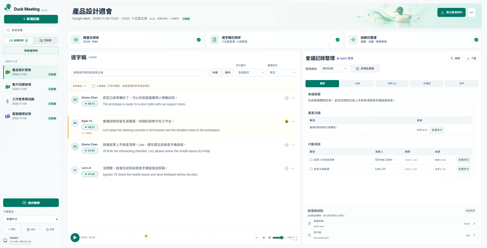

<h1 align="center">Duck Meeting｜AI 會議工作台 </h1>

<strong>記錄會議、核對原文，讓你已有的 Agent 接手整理。</strong> 
Duck Meeting 可記錄 Google Meet、Microsoft Teams 與現場會議。錄音和逐字稿集中在本機工作台，再交給你已有的 Codex 或 Claude Code 整理決議、待辦和可編輯的郵件草稿。

    
   
   
   

<a href="https://github.com/jaylooloomi/i-want-to-duck-meeting/releases/latest">下載 Windows x64 安裝包</a> · <a href="README.md">English</a>

 
Windows 實際介面 · v0.3.8 · 虛構會議資料

## 你可以做什麼

- **收音與即時閱讀。** 錄音、看即時字幕與翻譯，並標記重要發言。在專用 Meet 或 Teams 視窗可查看近期字幕和結束記錄，Meet 另支援暫停與繼續。
- **回聽與核對。** 搜尋原文或翻譯，點逐字稿時間回聽，或由已連結的決議與待辦回到來源。用 `openmeeting crosscheck <ID>` 核對平台字幕與既有錄音轉錄，或用 `openmeeting report <ID>` 產生審閱草稿並驗證引文。
- **整理與追蹤。** 選擇會議整理模板、追蹤跨會議待辦，並編輯或複製本機郵件草稿。

## 三步開始

1. 執行 Windows 安裝包，選擇 Codex 技能或 Claude Code 外掛。Chrome 與選用的 Agent 需另行安裝，Claude Code 整合需要 `claude` CLI。
2. 在新的 Agent 對話輸入 `幫我開會 <會議連結>`，視情況登入或等候主持人放行。現場會議可直接從 Duck Meeting 開始麥克風收音。
3. 散會後請 Agent 整理這場會議，再回到 Duck Meeting 核對摘要、決議、待辦與郵件草稿。

[安裝與更新](docs/installation.md) · [逐字稿與引文核對說明](docs/transcript-review.md)

## 資料會送到哪裡

| 步驟 | 資料流向 |
| --- | --- |
| 會議記錄 | 錄音、字幕與逐字稿保存在本機。 |
| 即時翻譯 | 啟用時，逐字稿文字會送到 Google 翻譯服務。 |
| 會議整理 | 使用已登入 Agent 的帳號額度處理會議文字，Duck Meeting 無需另外設定摘要 API 金鑰。 |

[Agent 操作流程與架構](docs/AGENT_ARCHITECTURE.md)

放大查看逐字稿與會議紀錄

## 版本與授權

- **v0.3.9** 修正翻譯分批回傳時逐字稿閃動。 [發布說明](docs/releases/v0.3.9.md)
- **v0.3.8** 新增會議內控制、雙來源核對與引文審閱。 [發布說明](docs/releases/v0.3.8.md)

作者為 Arthur Wang（[@jaylooloomi](https://github.com/jaylooloomi)）。歡迎交流、回報問題或參與貢獻。 [回報問題](https://github.com/jaylooloomi/i-want-to-duck-meeting/issues) · [MIT 授權](LICENSE)
