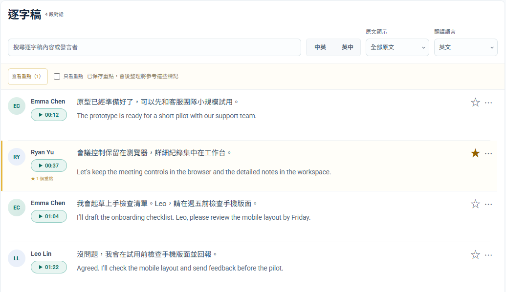
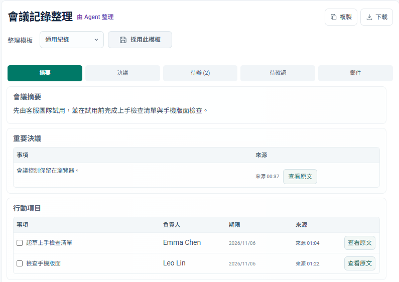

<h1>Duck Meeting｜AI 會議工作台 </h1>

[English](README.md)

記錄 Google Meet、Microsoft Teams 與現場會議。在本機工作台回聽、看逐字稿，再讓你已有的 Codex 或 Claude Code 整理決議、待辦和郵件草稿。

[下載 Windows 安裝包](https://github.com/jaylooloomi/i-want-to-duck-meeting/releases/latest) · v0.3.8 · Windows 10／11 x64

*Duck Meeting v0.3.8 實際介面，使用虛構會議資料。* [查看完整工作台截圖](docs/images/workspace-v0.3.8-zh-TW.png)

| 階段 | 你可以做什麼 |
| --- | --- |
| 開始 | 開啟專用 Meet／Teams 視窗，或開始現場收音。 |
| 記錄 | 看雙語逐字稿、標記重要發言。 |
| 核對 | 從逐字稿時間回聽，或由已連結的決議回到原文。 |
| 追蹤 | 使用整理模板、追蹤跨會議待辦、編輯郵件草稿。 |

## v0.3.8 新功能

- **會議內控制。** 在專用 Meet／Teams 視窗查看近期字幕、結束記錄。Meet 也可暫停與繼續。
- **雙來源核對。** `openmeeting crosscheck <ID>` 對齊平台字幕和既有錄音轉錄，標出數字、日期與措辭差異。
- **引文驗證。** `openmeeting report <ID>` 產生審閱草稿。提供審閱 JSON 後，可驗證引文是否存在於指定段落。

[操作說明](docs/transcript-review.md) · [發布說明](docs/releases/v0.3.8.md)

## 三步開始

1. 執行 Setup 並選擇 Agent 整合。另需 Chrome 和選用的 Agent。Claude Code 整合需要 `claude` CLI。
2. 在新對話貼上 Meet 或 Teams 連結並請 Agent 記錄。視情況登入與等候主持人放行。
3. 散會後說「整理這場會議」，回到 Duck Meeting 查看紀錄、待辦與本機郵件草稿。

## 帳號與資料

錄音與逐字稿保存在本機。標準流程使用既有 Agent 額度，不需另設摘要 API 金鑰。Agent 整理可能將文字送往所選服務，選用即時翻譯則會將文字送往 Google。v0.3.8 已用模擬 Meet 測試會議控制，真人 Meet／Teams 尚待驗收。

[安裝與更新](docs/installation.md) · [Agent 架構](docs/AGENT_ARCHITECTURE.md) · [MIT 授權](LICENSE)
