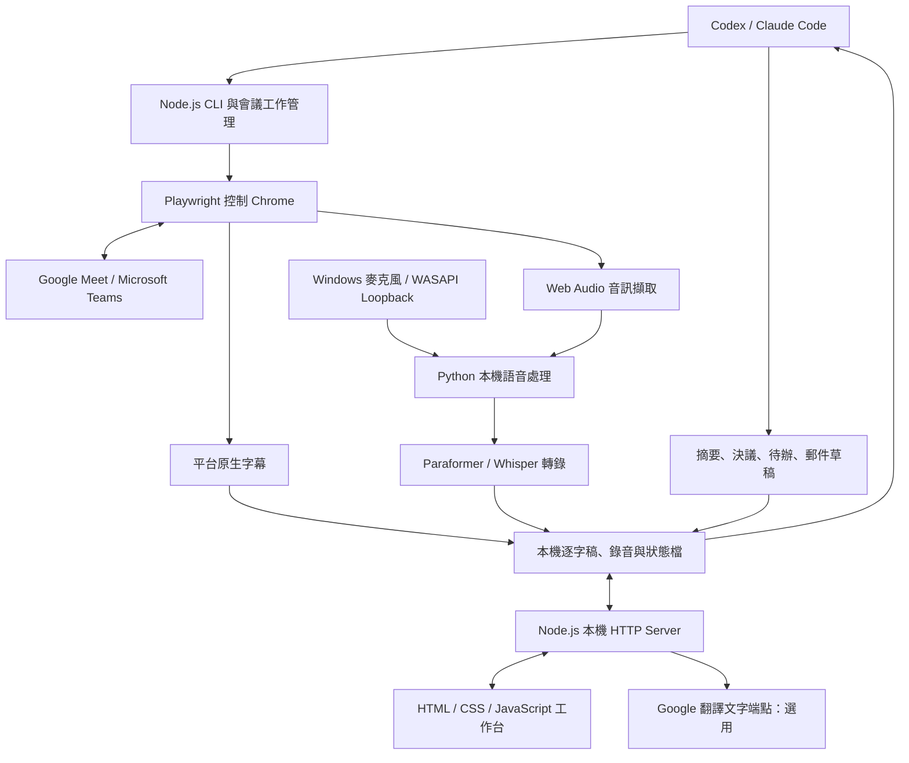

# Duck Meeting 技術棧與架構

依據專案 v0.3.3 原始碼整理；更新日期：2026-10-31。本文描述已實作的技術，不代表所有外部平台與真人會議情境都已驗收。

## 架構定位

這是一個以 Windows 本機運作為主的會議記錄工具：Node.js 同時提供 CLI、會議工作管理及本機 HTTP API／網頁，前端是原生網頁，Python 子程序執行音訊處理與語音辨識。Codex 技能與 Claude Code 外掛提供 Agent 操作入口。Windows 安裝版不是 Electron 應用，操作介面由瀏覽器開啟。

## 各層使用技術

| 層級 | 技術 | 實際用途與程式入口 |
| --- | --- | --- |
| 前端 | 原生 HTML、CSS、JavaScript | [index.html](../src/live/index.html)、[app.js](../src/live/app.js)、[workspace.js](../src/live/workspace.js)；不使用 React、Vue、前端打包框架或全域 Store 套件 |
| UI 與狀態 | DOM、CustomEvent、瀏覽器 localStorage | [theme.js](../src/live/theme.js)、[i18n.js](../src/live/i18n.js)、[locales.js](../src/live/locales.js)；深淺色、中英日韓介面與使用偏好。會議來源資料由本機 API 讀取 |
| 本機後端 | Node.js ≥22、ES Modules、原生 node:http | [cli.js](../src/cli.js)、[live-server.js](../src/live-server.js)、[session.js](../src/session.js)；API、工作生命週期與靜態頁面，不使用 Express 或 NestJS |
| 瀏覽器自動化 | playwright-core ^1.63.0、Google Chrome | [chrome.js](../src/chrome.js)、[meet](../src/meet)、[teams-browser.js](../src/teams-browser.js)；登入／選帳號接續、入會、字幕與會議狀態監控。平台頁面變更可能影響自動化 |
| 瀏覽器音訊 | Web Audio API、AudioWorklet、PCM、WebRTC／媒體音軌 | [audio-capture.js](../src/page/audio-capture.js)、[pcm-worklet.js](../src/live/pcm-worklet.js)；音訊擷取與處理。實際採用路徑依平台、頁面權限與設定而定 |
| Windows 收音 | Python、PyAudioWPatch、WASAPI Loopback | [windows_audio.py](../stt/windows_audio.py)；麥克風與播放裝置回送音訊。回送音訊可能包含該裝置上其他應用播放的聲音 |
| 即時語音流程 | Python、NumPy、VAD、說話者特徵、sherpa-onnx 1.13.7 | [live.py](../stt/live.py)；PCM 分段、語音活動偵測與發言者區分。特徵分群不等於確認真人身分 |
| 中文 ASR | Paraformer INT8 ONNX，透過 sherpa-onnx CPU 推論 | [paraformer.py](../stt/paraformer.py)；本機辨識，不把每段音訊送到雲端 ASR |
| 錄音轉錄／備援 | faster-whisper 1.2.1、PyAV、OpenCC | [transcribe.py](../stt/transcribe.py)、[stt.js](../src/stt.js)；錄音轉錄、多語模型能力與繁簡轉換。支援範圍取決於模型、設定與實測，不代表每條即時路徑都具備相同語言能力 |
| 翻譯 | Google Translate 網路文字端點 | [live-server.js](../src/live-server.js) 的 /api/translate；啟用時將文字送到 translate.googleapis.com。不是本機翻譯模型，也不是具 SLA 的正式付費 API 整合 |
| 會議整理 | 所屬 Codex／Claude Code Agent | [agent-summary.js](../src/agent-summary.js)、[Codex 技能](../codex/skills/openmeeting/SKILL.md)、[Claude 範本](../plugin/skills/meet/SKILL.md.tmpl)；Agent 讀取本場來源後產生摘要與草稿，不使用 Ollama 摘要後端 |
| 持久化 | 本機檔案：JSON、JSONL、Markdown、WAV | [config.js](../src/config.js)、[workspace-data.js](../src/workspace-data.js)；沒有 SQL／NoSQL 資料庫，也沒有獨立雲端儲存後端 |
| Windows 發佈 | Inno Setup、PowerShell、VBScript、內含 Node.js 24.13.0 | [build-windows.js](../scripts/build-windows.js)、[windows.iss](../installer/windows.iss)、[installer](../installer)；安裝、更新、解除安裝、Agent 整合與 GitHub Release 校驗下載 |
| 測試 | Node.js Test Runner／assert、Playwright、Python unittest | [unit](../test/unit)、[qa](../test/qa)、[integration](../test/integration)、[STT](../stt)；單元、API、瀏覽器、音訊及安裝驗證，詳見 [測試報告](../TEST_SUMMARY.md) |

JavaScript 執行階段唯一直接 npm 依賴是 playwright-core；語音辨識依賴另由 Python 環境管理，見 [requirements.txt](../stt/requirements.txt) 與 [requirements-live.txt](../stt/requirements-live.txt)。上表列出的固定 Python 版本來自這兩個檔案；模型檔案須另外準備，不隨小型安裝包完整內附。

## 字幕、錄音與整理的資料流

1. Agent／CLI 啟動會議工作；必要時由使用者完成平台登入或授權，背景程序接續監控入會。
2. 平台原生字幕優先作為來源；錄音與本機 ASR 提供備援與會後核對，並非每句都已經由兩個引擎達成一致。
3. 本機 Server 提供逐字稿、錄音播放、搜尋、星標、來源關聯及郵件草稿 API；頁面輪詢更新內容，不是 WebSocket 推送架構。
4. 啟用翻譯時，由後端呼叫網路文字翻譯端點；速度與可用性取決於網路、外部服務及佇列狀態。
5. 會議完成後，摘要工作進入等待 Agent 狀態，由所屬 Agent 讀來源並寫入會議紀錄。自動接手需宿主對話／背景追蹤仍在運作，不等同於本機服務內建常駐 LLM。
6. 郵件頁只保存與匯出草稿。建立信件或寄送須由 Agent 透過另外授權的郵件工具處理。

## 儲存與外部服務界線

- 安裝版預設資料根目錄：`%LOCALAPPDATA%\DuckMeeting\data`；程式安裝目錄：`%LOCALAPPDATA%\Programs\DuckMeeting`。原始碼版可透過 `OPENMEETING_HOME` 指定資料根目錄。
- 每場資料保存在 `meetings/<ID>/`，包含狀態、原文逐字稿、錄音、重點、會議紀錄與草稿；依功能啟用與成功狀態，實際檔案可能不同。
- Chrome 登入資料與本機模型亦存放於資料根目錄相關子目錄。不要將會議、登入資料、模型或憑證加入 Git。
- 「本機儲存／本機 ASR」不代表完全離線：會議平台、選用翻譯、模型初次下載及 GitHub 更新需要網路；Codex／Claude 的來源處理界線依宿主與使用方式而定。
- 安裝程式目前未簽章；SHA256 僅驗證完整性。解除安裝與升級的資料保留規則見 [README](../README.zh-TW.md)。

## 驗收限制

完整技術組件存在，不等於所有真人會議情境都通過。目前已知整場 ZIP 匯出的音訊可能損壞，應另行保留原始 WAV；既有跳過案例及測試範圍見 [BUG_REPORT.md](../BUG_REPORT.md) 與 [v0.3.3 QA 報告](qa/reports/release-0.3.3.md)。
