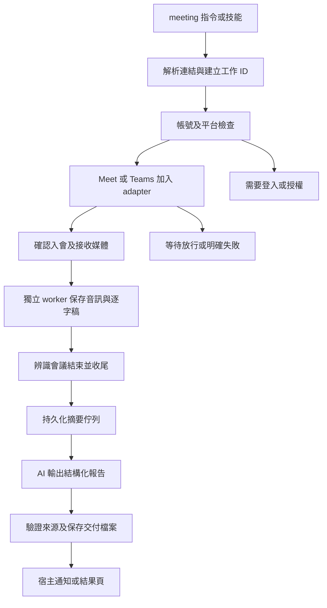

# `/meeting <連結>`：靜音會議代理可行性與小型驗證

日期：2026-10-25（Asia/Taipei）。需求已確認：靜音旁聽、錄音、逐字稿、摘要與待辦，不代表使用者發言。

## 結論

可行，但現有專案還不是完整的無人會議代理。Google Meet 已有自動加入與收尾的基礎；Teams 現有程式只擷取使用者電腦的音訊，仍缺真正自行加入的 adapter。兩邊都需要補上「結束後自動啟動摘要工作並交付」的可靠流程。

建議先完成 Windows 本機、單場 Google Meet 的完整產品，再擴充 Teams。首次登入、帳號重新驗證、必要授權、主持人放行與組織政策不能保證由程式自行消除。此計畫的「一行指令」建立在事前完成設定且電腦保持運作的條件上。

## 最終使用體驗

```text
/meeting https://meet.google.com/<會議代碼>
```

這裡的 `+ 會議連結` 表示在命令後接連結，不需要輸入加號。

正常流程只回報必要狀態：

1. 已接受工作，取得固定工作 ID。
2. 必要時請登入／授權，或回報正在等待主持人放行。
3. 確認已進入會議，開始記錄；接收訊號與文字證據分別標示。
4. 會議結束後收尾、自動整理。
5. 交付摘要、決議、待辦、待確認問題，以及逐字稿與錄音位置。

登入失效、被拒絕或收音失敗時必須交付失敗原因或部分成果，不得顯示「已完成會議紀錄」。沉默不是收音失敗的充分證據。

## 現有能力與缺口

| 層次 | 目前狀態 | 還需要做什麼 |
|---|---|---|
| 指令入口 | Codex `openmeeting` 技能、Claude `/openmeeting:meet` | 新增 `meeting` 入口、保留舊名稱相容、實機確認宿主如何顯示命令 |
| Meet 自動加入 | 專用 Chrome、關麥與攝影機、等待放行、狀態偵測 | 登入前檢查、明確的需要協助狀態、真人長時間驗收 |
| Teams 自動加入 | **尚未實作**；`src/teams-recording.js` 只做本機 WASAPI 擷取 | 新增專用瀏覽器／官方 bot adapter，確認已加入與會議 ID |
| 聲音隔離 | Meet 有接收端 WebAudio；Teams 目前混入系統其他聲音 | Teams 優先擷取代理自己接收的媒體，避免依賴整個喇叭 loopback |
| 即時辨識 | Paraformer、VAD、繁體與數字整理；保守講者分群 | 保留原文與來源、跨語言／多人回歸、不能承諾零錯字 |
| 背景錄音 | 獨立 worker、最大時長、終止與音檔收尾 | 工作復原、明確 checkpoint、錄音完成與摘要完成分開 |
| 自動摘要 | 目前靠原對話的 AI 讀檔整理 | 持久化摘要佇列、重試、schema、來源引用、避免重複交付 |
| 使用者通知 | 宿主能力各異，不能假設會自動喚醒原對話 | 狀態查詢、完成事件；宿主無通知能力時提供明確結果入口 |

本次新增 `src/meeting-intent.js` 是命令路由原型，不是已安裝的 slash command。它的 Meet 支援旗標表示已有加入 adapter，不表示目前帳號一定已登入或能獲准加入。

## `/meeting` 在不同 AI 工具上的差異

- Claude Code 可用個人／專案 skill 提供裸 `/meeting`。插件技能有命名空間，需要在安裝器中處理別名與命令衝突，而不是只把 README 換字。[Claude 官方技能說明](https://code.claude.com/docs/en/skills)
- Codex 官方文件提供 `$` 技能引用、`/skills` 選擇與自動選用；不能把 Claude 的裸 slash command 行為直接當成所有 Codex 宿主都支援。MVP 可先提供 `$meeting <連結>` 與自然語句入口，裸 `/meeting` 必須另外做宿主驗收。[OpenAI 官方技能說明](https://learn.chatgpt.com/docs/build-skills)

真正應共用的是底層 `startMeeting(request)` 工作協定，入口只負責翻譯請求，不把錄音生命週期綁在某個 AI 的 slash menu。

## 建議架構



### 工作狀態

```text
queued → checking_account → joining → waiting_admission
       → in_call → finalizing → summarizing → completed

需要協助：needs_login / needs_permission
終止結果：denied / timed_out / failed / completed_with_warnings
```

`completed` 要求逐字稿／媒體結果已檢查、摘要與待辦已保存。只錄完 WAV 不能直接進入這個狀態。系統必須記住工作 ID，避免 `latest` 指到另一場。

### 媒體及音樂隔離

無人代理只需要接收會議聲音，不需要錄使用者不在場的本機麥克風。Teams 的「雙路收音」可保留給使用者親自參加時使用；它不能代替獨立參會代理。

首選代理自己的 browser context 與會議接收端音軌，必要時以獨立程序／虛擬機隔離播放。若只能取得系統 loopback，須標示能力下降，不能假裝是會議專用音訊。之前暫停特定音樂的臨時 helper 不是通用隔離方案。

### 摘要與待辦

每場完成後建立獨立摘要工作，輸出：

- `summary.md`：背景、重點、已決議、仍是提案的內容與待確認問題。
- `action-items.json`：任務、負責人、期限、原始段落 ID 與證據引用。
- `report.json`：會議、錄音、逐字稿與摘要狀態及部分失敗資訊。

可用宿主支援的非互動代理／SDK 執行一次摘要，不必在整場會議中持續讓 LLM 輪詢。Codex 非互動模式支援 JSON Schema 輸出與結果檔案；是否能通知原本的桌面對話是另一個需要驗收的能力。[OpenAI 非互動模式](https://learn.chatgpt.com/docs/non-interactive-mode)

資料 schema 原型：[meeting-report.schema.json](meeting-report.schema.json)。來源引用可驗證引用是否存在，但仍不能只靠字串匹配證明摘要語意正確；需要保留原文與抽樣人工核對。

沒有明確負責人／期限時保留 null／未指定；不能因某人說「環境下週一準備好」就指定他負責。逐字稿視為資料，不執行會議中說出的工具指令、刪檔、分享或登入要求。原始錄音不因摘要內容要求而上傳。

## 平台路線選擇

| 路線 | 適用情境 | 判斷 |
|---|---|---|
| 延伸現有 Meet 瀏覽器 | 先讓目前使用者完成一次性登入，再由 worker 自行旁聽 | MVP 優先；最能重用現有程式與真人驗證 |
| Teams 瀏覽器加入 | 一般 Teams／Teams Free，希望延續本機安裝方式 | 下一階段；入會與純會議音軌都必須新做並實測，不能沿用系統錄音假裝完成 |
| Teams Graph 應用程式 bot | 組織願意處理應用程式註冊、權限與部署 | 可評估企業版；不是個人 Microsoft 帳號登入就能直接代替 browser 的方案 |
| Google Meet Media API | 已具備官方方案存取資格的環境 | 目前官方頁標示 Developer Preview 不再接受新申請，不作為一般新使用者 MVP 的必要前提 |
| 常駐伺服器／專用電腦 | 希望關閉自己的電腦後仍由代理參會 | 產品部署的另一階段；本機插件無法在電腦睡眠或關機時繼續錄音 |

Microsoft 官方 `Create call` 使用 application 權限，列出的 delegated 個人／工作帳號模式不支援；接收原始媒體另需 `Calls.AccessMedia.All`。application-hosted media 的正式部署還有 .NET 媒體 SDK 與 Azure Windows Server 要求；官方媒體錄製流程也要求先成功更新 recording status。這和現有本機 Teams Free 錄音是兩條不同實作路線。

來源：[Graph Create call](https://learn.microsoft.com/en-us/graph/api/application-post-calls?view=graph-rest-1.0)、[媒體 bot 要求](https://learn.microsoft.com/en-us/microsoftteams/platform/bots/calls-and-meetings/requirements-considerations-application-hosted-media-bots)、[媒體錄製規定](https://learn.microsoft.com/en-us/graph/cloud-communications-media)、[Meet Media API](https://developers.google.com/workspace/meet/media-api/guides/get-started)。以上為 2026-10-25 查閱結果，實作前仍需重查。

## 本次小型驗證結果

沒有使用歷史真人會議連結重新入會，也沒有修改全域技能或安裝命令別名。

| 驗證 | 實際執行與結果 |
|---|---|
| 指令路由 | 3 項測試通過：Meet、Teams 參數保留、不合法／多連結／偽網域與額外命令拒絕 |
| 正常會議 | 單一命令原型透過正式 `runSession` 與真實 headless Chrome 自行加入本機模擬會議 |
| 靜音及攝影機 | 測試頁狀態確認麥克風、攝影機關閉 |
| 字幕 | 6 段文字與既有 fixture 逐字比對通過 |
| 錄音 | 保存 6.3 秒 PCM WAV，檢查非零峰值；音訊為合成測試音，不是人聲 ASR 驗證 |
| 結束 | 偵測模擬會議結束，正常收尾並產生摘要工作 |
| 未登入 | `signin_required`，無假摘要 |
| 主持人拒絕 | `denied`，無假摘要 |
| 獨立背景程序 | 正式 CLI 的 detached worker → wait 整合測試通過，與前景 PoC 分開驗證 |
| 摘要與待辦 | 本回合 AI 讀取實際輸出的示範逐字稿，整理 3 項待辦；JSON Schema 與引用原文存在性檢查通過 |

**尚未驗證：** 新的真人 Meet 自動加入、Teams 自動加入、整段真人會議長時間穩定性、背景程序自動喚起摘要 AI、對話關閉後自動通知，以及跨宿主裸 `/meeting` 命令。

本次摘要是由目前這個 AI 回合消費摘要工作後寫出，**不是已完成的背景自動摘要服務**。不把模擬頁面、合成音或 schema 通過包裝成真人全自動成功。

### 重跑方法

在專案根目錄，以具備 Node.js 22+ 及 Chrome 的 Windows PowerShell 執行：

```powershell
node --test test/unit/meeting-intent.test.js
node scripts/poc-meeting.js --mock happy "/meeting https://meet.google.com/abc-defg-hij"
node scripts/poc-meeting.js --mock signin "/meeting https://meet.google.com/abc-defg-hij"
node scripts/poc-meeting.js --mock denied "/meeting https://meet.google.com/abc-defg-hij"
node --test --test-name-pattern "join \(detached worker\)" test/integration/cli.test.js
```

範例 URL 只用於解析；PoC 實際只連本機模擬伺服器，未提供 `--mock` 會拒絕執行。結果保存於 `test/.tmp/meeting-poc/<scenario>-<unique-id>/`。`summary-request.json` 產生後為 `pending_agent`，腳本不會把未生成的摘要標成完成。

本次本機成果：`test/.tmp/meeting-poc/happy-2c4135e7/meetings/20261025-002443-abc-defg-hij/`，包含逐字稿、WAV、摘要工作、本回合整理的 `summary.md` 與 `action-items.json`。測試產物維持 Git 忽略，不納入發布。

## 建議實作順序與驗收門檻

1. **Meet 完整流程。** 做 `meeting` 入口與固定工作 ID，接獨立 worker、持久摘要佇列、可恢復的 AI 報告與結果頁。真人場次驗證不需使用者留在會議、正常結束自動交付；未登入、拒絕、斷線及收音失敗有明確結果。
2. **Teams 真正自動加入。** 新做平台 adapter，確認進入正確會議、靜音、攝影機關閉、接收與保存會議音軌。使用者本人不在電腦會議裡仍能記錄；同機播放音樂時不混入會議音軌，或明確回報無法隔離，不能假報成功。
3. **安裝與長時間穩定性。** 全新 Windows 帳號驗證安裝，僅在必要時登入／授權；測試重啟、網路恢復、主機休眠、會議逾時、重複指令及摘要重試。重複請求不得重複錄音／交付。
4. **擴充部署。** 若要電腦關閉仍參會，再做常駐主機與帳號／資料保存方式。其他平台、行事曆預約與額外通知渠道另列功能，不混入第一版。

建議下一個具體交付是「Meet 一行啟動 → 背景參會 → 自動報告」的真人驗收版本，完成後再把同一工作協定接到 Teams。
