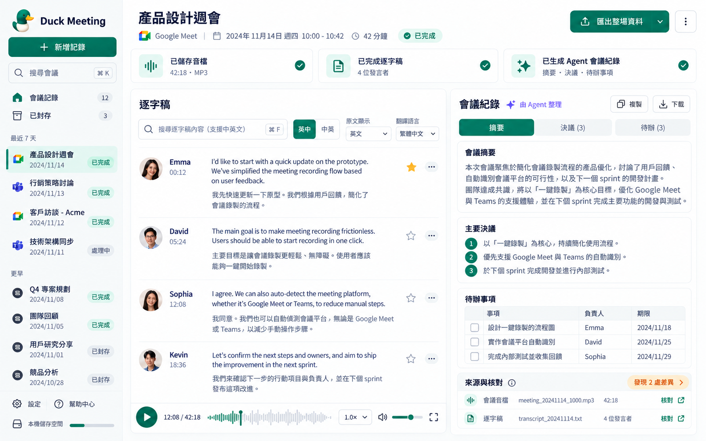
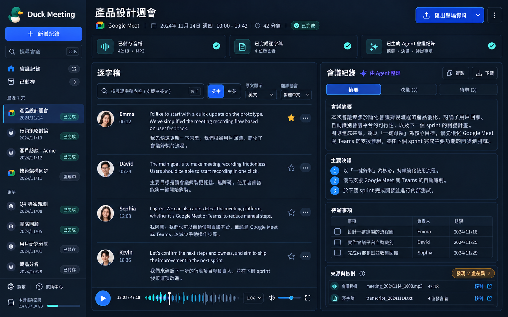
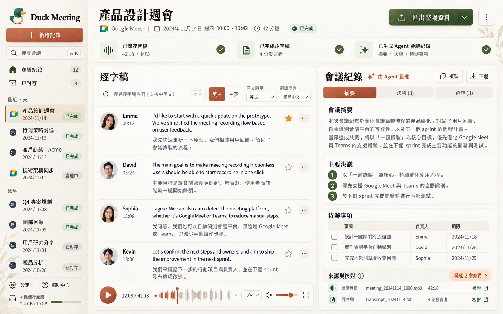
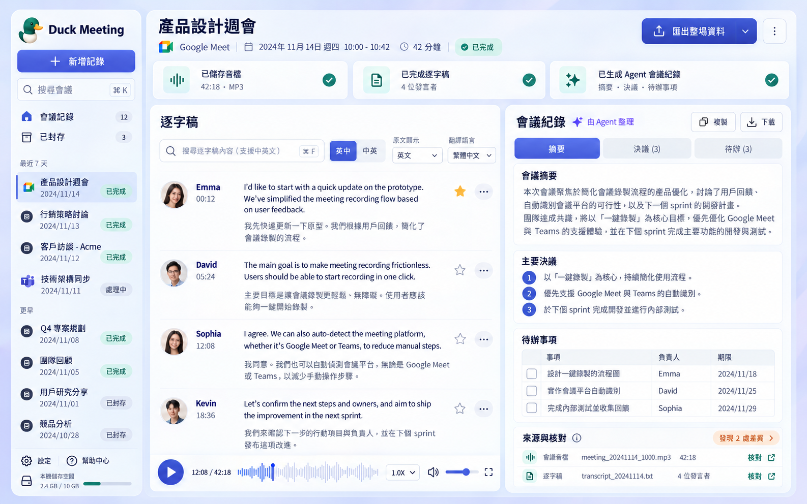
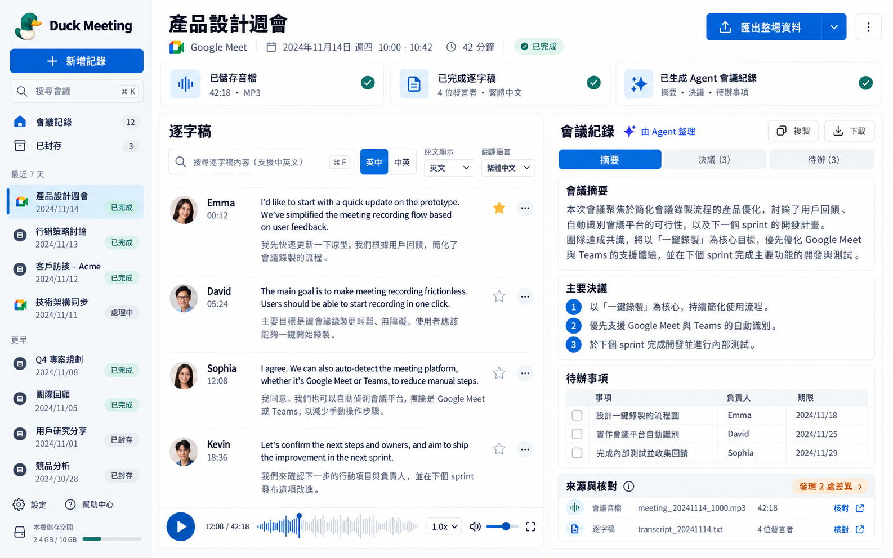

# Duck Meeting — five visual design concepts

Generated with the built-in image_gen tool on 2026-10-30. These are raster UI design concepts, not implementation screenshots. Meeting names, faces, dates, counts and storage figures are illustrative. The final five retain the meeting-history, bilingual transcript, important-speech stars, player, Agent notes, decisions, action table and source-review areas. Production app code was not changed for this request.

## 1. 翡翠極簡

### Final generation prompt

Use case: ui-mockup. Generate one polished high-fidelity desktop app design image, landscape 16:10, straight-on full application screenshot filling the canvas, no laptop frame, no perspective, no collage. Product Duck Meeting with a small tasteful duck icon. Traditional Chinese UI, crisp readable typography. A real productivity tool for Google Meet and Teams meeting recording. Consistent core functionality: left sidebar Duck Meeting brand, + 新增記錄, 搜尋會議, grouped meeting history with statuses, archive tabs, settings/help and local-storage footer. Main header 產品設計週會, Google Meet, date, duration, 已完成, 匯出整場資料. Slim saved-audio/transcript/Agent-notes status strip. Two large working panels: left 逐字稿 with search, 英中 / 中英 buttons, 原文顯示 and 翻譯語言 selects. Four speaker rows with avatars, time, English original and Traditional Chinese translation, discreet star for important speech; use short realistic sentences about simplifying meeting recording. Bottom real-looking audio player with play button, detailed waveform, 12:08 / 42:18, speed and volume. Right 會議紀錄 with 由 Agent 整理, copy/download, 摘要 / 決議 / 待辦 tabs, short summary, numbered decisions, action table 事項/負責人/期限, and 來源與核對 with a two-difference review badge. All major controls must be visible, coherent spacing, excellent hierarchy and readability. No promotional copy, no extra invented modules, no watermarks.
Style: Emerald Minimal, pearl-white/gray with restrained emerald accents, quiet premium enterprise productivity design. Use the reference only for layout and meeting-tool functionality. Keep Duck Meeting brand and Traditional Chinese. IMPORTANT: omit all claimed accuracy percentages, storage quotas, or statistical claims; use 已完成逐字稿 · 4 位發言者 only in the transcript status card. No invented product modules. This is the light emerald variant of the same tool.

Reference input: initial emerald meeting-tool concept generated in this session; used as layout/function reference. Final asset: `01-emerald-minimal.png`.

## 2. 深色專業

### Final generation prompt

Use case: ui-mockup. Generate one polished high-fidelity desktop app design image, landscape 16:10, straight-on full application screenshot filling the canvas, no laptop frame, no perspective, no collage. Product Duck Meeting with a small tasteful duck icon. Traditional Chinese UI, crisp readable typography. A real productivity tool for Google Meet and Teams meeting recording. Consistent core functionality: left sidebar Duck Meeting brand, + 新增記錄, 搜尋會議, grouped meeting history with statuses, archive tabs, settings/help and local-storage footer. Main header 產品設計週會, Google Meet, date, duration, 已完成, 匯出整場資料. Slim saved-audio/transcript/Agent-notes status strip. Two large working panels: left 逐字稿 with search, 英中 / 中英 buttons, 原文顯示 and 翻譯語言 selects. Four speaker rows with avatars, time, English original and Traditional Chinese translation, discreet star for important speech; use short realistic sentences about simplifying meeting recording. Bottom real-looking audio player with play button, detailed waveform, 12:08 / 42:18, speed and volume. Right 會議紀錄 with 由 Agent 整理, copy/download, 摘要 / 決議 / 待辦 tabs, short summary, numbered decisions, action table 事項/負責人/期限, and 來源與核對 with a two-difference review badge. All major controls must be visible, coherent spacing, excellent hierarchy and readability. No promotional copy, no extra invented modules, no watermarks.
CRITICAL: Duck Meeting must remain the brand. Traditional Chinese labels and bilingual English/Chinese speaker rows are mandatory. Do not replace the meeting tool with a generic dashboard. No upgrade subscription panels, no invented accuracy percentages. Same meeting-feature inventory as the reference; restyle colors, typography and component treatment.
STYLE: Midnight professional: deep charcoal and midnight navy surfaces, blue-violet accents, cyan audio waveform, restrained borders, high readability. A sophisticated dark mode for a real meeting transcription product.

Reference input: initial emerald meeting-tool concept generated in this session; used as layout/function reference. Final asset: `02-midnight-professional.png`.

## 3. 暖色編輯

### Final generation prompt

Use case: ui-mockup. Generate one polished high-fidelity desktop app design image, landscape 16:10, straight-on full application screenshot filling the canvas, no laptop frame, no perspective, no collage. Product Duck Meeting with a small tasteful duck icon. Traditional Chinese UI, crisp readable typography. A real productivity tool for Google Meet and Teams meeting recording. Consistent core functionality: left sidebar Duck Meeting brand, + 新增記錄, 搜尋會議, grouped meeting history with statuses, archive tabs, settings/help and local-storage footer. Main header 產品設計週會, Google Meet, date, duration, 已完成, 匯出整場資料. Slim saved-audio/transcript/Agent-notes status strip. Two large working panels: left 逐字稿 with search, 英中 / 中英 buttons, 原文顯示 and 翻譯語言 selects. Four speaker rows with avatars, time, English original and Traditional Chinese translation, discreet star for important speech; use short realistic sentences about simplifying meeting recording. Bottom real-looking audio player with play button, detailed waveform, 12:08 / 42:18, speed and volume. Right 會議紀錄 with 由 Agent 整理, copy/download, 摘要 / 決議 / 待辦 tabs, short summary, numbered decisions, action table 事項/負責人/期限, and 來源與核對 with a two-difference review badge. All major controls must be visible, coherent spacing, excellent hierarchy and readability. No promotional copy, no extra invented modules, no watermarks.
CRITICAL: Duck Meeting must remain the brand. Traditional Chinese labels and bilingual English/Chinese speaker rows are mandatory. Do not replace the meeting tool with a generic dashboard. No upgrade subscription panels, no invented accuracy percentages. Same meeting-feature inventory as the reference; restyle colors, typography and component treatment.
STYLE: Warm editorial: ivory and parchment background, terracotta and muted olive accents, distinguished serif section headings, readable sans-serif controls, subtle paper texture, calm professional meeting notebook.

Reference input: initial emerald meeting-tool concept generated in this session; used as layout/function reference. Final asset: `03-warm-editorial.png`.

## 4. 柔和玻璃

### Final generation prompt

Use case: ui-mockup. Generate one polished high-fidelity desktop app design image, landscape 16:10, straight-on full application screenshot filling the canvas, no laptop frame, no perspective, no collage. Product Duck Meeting with a small tasteful duck icon. Traditional Chinese UI, crisp readable typography. A real productivity tool for Google Meet and Teams meeting recording. Consistent core functionality: left sidebar Duck Meeting brand, + 新增記錄, 搜尋會議, grouped meeting history with statuses, archive tabs, settings/help and local-storage footer. Main header 產品設計週會, Google Meet, date, duration, 已完成, 匯出整場資料. Slim saved-audio/transcript/Agent-notes status strip. Two large working panels: left 逐字稿 with search, 英中 / 中英 buttons, 原文顯示 and 翻譯語言 selects. Four speaker rows with avatars, time, English original and Traditional Chinese translation, discreet star for important speech; use short realistic sentences about simplifying meeting recording. Bottom real-looking audio player with play button, detailed waveform, 12:08 / 42:18, speed and volume. Right 會議紀錄 with 由 Agent 整理, copy/download, 摘要 / 決議 / 待辦 tabs, short summary, numbered decisions, action table 事項/負責人/期限, and 來源與核對 with a two-difference review badge. All major controls must be visible, coherent spacing, excellent hierarchy and readability. No promotional copy, no extra invented modules, no watermarks.
CRITICAL: Duck Meeting must remain the brand. Traditional Chinese labels and bilingual English/Chinese speaker rows are mandatory. Do not replace the meeting tool with a generic dashboard. No upgrade subscription panels, no invented accuracy percentages. Same meeting-feature inventory as the reference; restyle colors, typography and component treatment.
STYLE: Soft glass: bright frosted translucent white panels on a subtle lavender/ice-blue background, indigo accents, rounded 16px cards, airy hierarchy and strong text contrast. Meeting workspace, absolutely no project dashboard, charts or statistics.

Reference input: initial emerald meeting-tool concept generated in this session; used as layout/function reference. Final asset: `04-soft-glass.png`.

## 5. 瑞士網格・科技藍

### Final generation prompt

Use case: ui-mockup. Generate one polished high-fidelity desktop app design image, landscape 16:10, straight-on full application screenshot filling the canvas, no laptop frame, no perspective, no collage. Product Duck Meeting with a small tasteful duck icon. Traditional Chinese UI, crisp readable typography. A real productivity tool for Google Meet and Teams meeting recording. Consistent core functionality: left sidebar Duck Meeting brand, + 新增記錄, 搜尋會議, grouped meeting history with statuses, archive tabs, settings/help and local-storage footer. Main header 產品設計週會, Google Meet, date, duration, 已完成, 匯出整場資料. Slim saved-audio/transcript/Agent-notes status strip. Two large working panels: left 逐字稿 with search, 英中 / 中英 buttons, 原文顯示 and 翻譯語言 selects. Four speaker rows with avatars, time, English original and Traditional Chinese translation, discreet star for important speech; use short realistic sentences about simplifying meeting recording. Bottom real-looking audio player with play button, detailed waveform, 12:08 / 42:18, speed and volume. Right 會議紀錄 with 由 Agent 整理, copy/download, 摘要 / 決議 / 待辦 tabs, short summary, numbered decisions, action table 事項/負責人/期限, and 來源與核對 with a two-difference review badge. All major controls must be visible, coherent spacing, excellent hierarchy and readability. No promotional copy, no extra invented modules, no watermarks.
CRITICAL: Duck Meeting must remain the brand. Traditional Chinese labels and bilingual English/Chinese speaker rows are mandatory. Do not replace the meeting tool with a generic dashboard. No upgrade subscription panels, no invented accuracy percentages. Same meeting-feature inventory as the reference; restyle colors, typography and component treatment.
STYLE: Swiss precision: crisp white with cool gray, strong black typography and cobalt blue accent, exact disciplined grid, restrained square corners, confident headings, functional transcript and notes columns.

Reference input: initial emerald meeting-tool concept generated in this session; used as layout/function reference. Final asset: `05-swiss-grid.png`.
